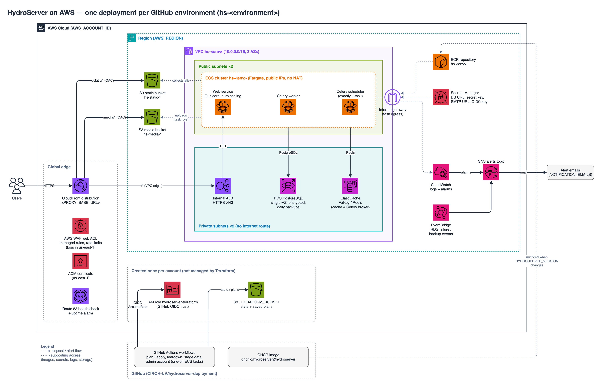

# HydroServer Deployment Workflows

**Description**:
This repository contains GitHub Actions workflows and environments for deploying and managing
[**HydroServer**](https://www.hydroserver.org) deployments in [**Amazon Web Services**](https://aws.amazon.com)
(AWS). The [installation guide](INSTALL.md) walks you through how to set up a new HydroServer deployment, and
[Usage](#usage) below covers managing and tearing down existing deployments. The workflows in this repository use [**Terraform**](https://developer.hashicorp.com/terraform)
infrastructure-as-code (IaC) to provision and manage HydroServer deployments in AWS.

Each deployment runs HydroServer's web service, Celery worker, and Celery scheduler on **ECS Fargate**, with an
**RDS PostgreSQL** database, an **ElastiCache** cache and task queue, and **S3** buckets for static and media files.
**CloudFront** serves HydroServer at your domain: it sends `/static/*` and `/media/*` to the buckets and everything
else to an internal load balancer in front of the web service. **AWS WAF** filters and rate limits requests before
they reach CloudFront's origins.

- **Technology stack**: [Terraform](https://developer.hashicorp.com/terraform) infrastructure-as-code run by
  [GitHub Actions](https://docs.github.com/en/actions) workflows, deploying to AWS. This is a standalone deployment
  repository, not a library. It deploys published [HydroServer](https://github.com/hydroserver2/hydroserver) releases
  and doesn't contain HydroServer's source code.
- **Status**: Beta. See the [CHANGELOG](CHANGELOG.md) for changes.
- **Production instance**: [hydroserver.ciroh.org](https://hydroserver.ciroh.org) (coming soon).
- **Related projects**: This repository adapts HydroServer deployment workflows originally written for Google Cloud
  Platform (GCP) to AWS.

**Architecture**: The AWS resources Terraform creates for each deployment.



## Dependencies

- An **AWS account** that will host HydroServer, and permission to create IAM roles and policies, an IAM OIDC
  identity provider, an S3 bucket, and ACM certificates in it.
- A **GitHub repository** with GitHub Actions and
  [environments](https://docs.github.com/en/actions/deployment/targeting-different-environments/using-environments-for-deployment)
  enabled. Each environment is one HydroServer deployment.
- A **domain or subdomain** for HydroServer, with access to its DNS records to validate certificates and point it at
  CloudFront.
- The [**AWS CLI**](https://aws.amazon.com/cli/) for the one-time account setup.
- A released **HydroServer version** to deploy. See https://github.com/hydroserver2/hydroserver/releases.
- **Terraform** and its AWS provider don't need to be installed locally to deploy. The workflows pin the Terraform
  version, and provider versions are locked in `terraform/.terraform.lock.hcl`. See
  [Upgrade Terraform or Provider Versions](#upgrade-terraform-or-provider-versions). Contributors changing the
  Terraform configuration should install the same version to run the checks in
  [How to test the software](#how-to-test-the-software).

## Installation

See [INSTALL](INSTALL.md) for setting up the GitHub environment and AWS account and creating a new deployment. It
also lists the [IAM permissions](INSTALL.md#required-iam-permissions-for-terraform-aws-role) Terraform's deployer
role needs.

## Configuration

The variables used to set up a deployment, including its AWS account, region, certificates, and deletion protection,
are described in [INSTALL](INSTALL.md). The following optional settings control how HydroServer and the services it
runs on are configured.

1. In your GitHub environment, the following variables can be used to configure the services HydroServer will be
   deployed to:

   - **DEBUG_ENABLED**
     Enables Django debug features. This should only be set to `True` for development instances, and `False` for testing
     and production instances.
     *Default*: `False`

   - **LOG_FORMAT**
     The format HydroServer emits application logs in.
     *Default*: `json`

   - **LOG_RETENTION_DAYS**
     The number of days CloudWatch keeps HydroServer container logs and WAF logs.
     *Default*: `30`

   - **ALLOWED_HOSTS**
     A comma-separated list of host/domain names HydroServer is allowed to serve.
     *Example*: `hydroserver.ciroh.org,hydroservertest.ciroh.org`
     *Default*: `` (empty)

   - **CSRF_TRUSTED_ORIGINS**
     A comma-separated list of trusted origins, including the HTTP scheme, that are allowed to authenticate with
     HydroServer's APIs, such as a separately hosted web app.
     *Example*: `https://app.example.com`
     *Default*: `` (empty)

   - **NOINDEX_ENABLED**
     Tells search engines not to index HydroServer when set to `True`.
     *Default*: `False`

   - **SESSION_COOKIE_NAME**
     The name of HydroServer's session cookie.
     *Default*: `hs_session`

   - **SERVICE_ACCOUNT_EMAIL_DOMAIN**
     The email domain used for HydroServer's auto-generated service account emails.
     *Default*: `hydroserver.local`

   - **AUTO_EMAIL**
     The email address HydroServer sends account management emails from, such as password reset and verification
     emails. Set this for any deployment that sends email, and make sure the mail server in the **SMTP_URL** secret
     is allowed to send from it. The default isn't a deliverable address.
     *Example*: `no-reply@hydroserver.ciroh.org`
     *Default*: `no-reply@127.0.0.1:1025`

   - **ACCOUNT_SIGNUP_ENABLED**
     Allows anyone to register accounts on HydroServer when set to `True`. If set to `False`, all regular user
     accounts will need to be created by HydroServer administrators.
     *Default*: `True`

   - **ACCOUNT_OWNERSHIP_ENABLED**
     Allows new users to immediately create and own workspaces upon account creation when set to `True`. If set to
     `False`, HydroServer administrators will need to upgrade user accounts to allow workspace creation or ownership.
     *Default*: `True`

   - **SOCIALACCOUNT_SIGNUP_ONLY**
     Restricts user sign-up to third-party identity providers (e.g., Google) when set to `True`.
     *Default*: `False`

   - **IDP_OIDC_ENABLED**
     Enables HydroServer's OIDC identity provider feature when set to `True`. The RSA private key HydroServer
     uses to sign OIDC tokens is generated automatically by Terraform and stored in Secrets Manager.
     *Default*: `False`

   - **MEDIA_STORAGE_ENABLED**
     Enables media file storage in HydroServer when set to `True`.
     *Default*: `True`

   - **API_RATE_LIMITS**
     Controls HydroServer's API rate limits. Set to `False` to disable rate limiting entirely, or to a JSON
     object to override specific per-view rate limits.
     *Default*: `False`

   - **ACCOUNT_RATE_LIMITS**
     Controls HydroServer's account rate limits. Set to `False` to disable rate limiting entirely, or to a JSON
     object to override specific per-view rate limits.
     *Default*: `False`

   - **RDS_INSTANCE_CLASS**
     The instance class used for HydroServer's RDS database, which sets its vCPUs and memory. See
     https://aws.amazon.com/rds/postgresql/pricing/ for additional details.
     *Default*: `db.t4g.micro`

   - **RDS_ENGINE_VERSION**
     The PostgreSQL version installed on HydroServer's RDS database. HydroServer requires the use of PostgreSQL, but
     this variable can be used to periodically update the version of PostgreSQL used by HydroServer. Major version
     upgrades also replace the database's parameter group.
     *Default*: `17`

   - **RDS_ALLOCATED_STORAGE**
     The disk size allocated to HydroServer's RDS database, in gigabytes. The minimum is `20`.
     *Default*: `20`

   - **RDS_BACKUP_ENABLED**
     Enables daily backups for the RDS database when set to `true`. This variable must be set to `true` to enable
     staging data from this environment to another environment (such as staging production data to a testing instance).
     *Default*: `true`

   - **RDS_BACKUP_COUNT**
     The number of days RDS will retain daily backups if backups are enabled, up to `35`.
     *Default*: `14`

   - **GUNICORN_WORKERS**
     The number of Gunicorn web workers per web service container. This should be adjusted based on the number of
     vCPUs allocated to each web service container using the formula: `(2 x $vcpu_cores) + 1`.
     *Default*: `3`

   - **GUNICORN_THREADS**
     The number of threads each Gunicorn worker uses, so each web container handles workers × threads requests at
     once (12 by default). Each thread can hold its own database connection, so keep
     `ECS_WEB_MAX_COUNT × workers × threads`, plus the Celery worker concurrency, under the RDS instance's connection
     limit, which RDS sets from the instance class's memory (about 80 for `db.t4g.micro`).
     *Default*: `4`

   - **ECS_WEB_CPU**
     The number of vCPUs assigned to each web service container: `0.25`, `0.5`, `1`, `2`, `4`, `8`, or `16`.
     *Default*: `1`

   - **ECS_WEB_MEMORY**
     The amount of memory, in GB, assigned to each web service container. Fargate only allows certain amounts for each
     CPU size (for 1 vCPU, 2 to 8 GB), and the plan fails if the combination isn't allowed. See
     https://docs.aws.amazon.com/AmazonECS/latest/developerguide/fargate-tasks-services.html#fargate-tasks-size.
     *Default*: `2`

   - **ECS_WEB_MIN_COUNT**
     The minimum number of web service containers ECS will maintain.
     *Default*: `1`

   - **ECS_WEB_MAX_COUNT**
     The maximum number of web service containers ECS will maintain. ECS adds containers, up to this number, when the
     web service's average CPU utilization stays above **ECS_WEB_CPU_TARGET**.
     *Default*: `1`

   - **ECS_WEB_CPU_TARGET**
     The average CPU utilization, in percent, that ECS scales the web service to stay near.
     *Default*: `60`

   - **ECS_WORKER_CPU**
     The number of vCPUs assigned to each Celery worker container.
     *Default*: `1`

   - **ECS_WORKER_MEMORY**
     The amount of memory, in GB, assigned to each Celery worker container.
     *Default*: `2`

   - **ECS_WORKER_COUNT**
     The number of Celery worker containers ECS runs. Workers share one task queue, so adding containers increases how
     many background tasks run at once.
     *Default*: `1`

   - **CELERY_WORKER_CONCURRENCY**
     The number of tasks each Celery worker container runs at once. Keep this close to the container's vCPU count
     unless tasks spend most of their time waiting on network or database calls.
     *Default*: `2`

   - **ECS_SCHEDULER_CPU**
     The number of vCPUs assigned to the Celery scheduler container. Exactly one scheduler container always runs.
     During an update, ECS stops the old scheduler before starting the new one.
     *Default*: `1`

   - **ECS_SCHEDULER_MEMORY**
     The amount of memory, in GB, assigned to the Celery scheduler container.
     *Default*: `2`

   - **ECS_INIT_CPU**
     The number of vCPUs assigned to the one-off containers that run management commands (`migrate`,
     `collectstatic`, and admin account creation).
     *Default*: `1`

   - **ECS_INIT_MEMORY**
     The amount of memory, in GB, assigned to the one-off management command containers.
     *Default*: `2`

   - **ELASTICACHE_NODE_TYPE**
     The node type used for HydroServer's ElastiCache cache and task queue.
     *Default*: `cache.t4g.micro`

   - **ELASTICACHE_ENGINE**
     The ElastiCache engine, `valkey` or `redis`. Valkey is compatible with Redis and costs less.
     *Default*: `valkey`

   - **ELASTICACHE_ENGINE_VERSION**
     The version of the ElastiCache engine. The version must exist for the selected **ELASTICACHE_ENGINE**, so change
     this too when switching to `redis` (e.g., `7.1`).
     *Default*: `8.0`

   - **NOTIFICATION_EMAILS**
     A comma-separated list of email addresses that will receive CloudWatch alarm notifications
     (uptime, API error rate/latency, ECS and RDS resource saturation, and RDS availability and backup
     failures). Unlike the other configuration variables below, this one is never inherited from
     **SOURCE_ENVIRONMENT**. It must be set per environment. AWS emails each address a subscription confirmation
     link after the next apply, and nothing is sent to an address until it's confirmed. When **AWS_REGION** isn't
     `us-east-1`, each address gets a second confirmation for the uptime alarm.
     *Example*: `alice@example.com,bob@example.com`
     *Default*: `` (no email subscriptions are created)

   - **ALERT_5XX_THRESHOLD**
     The rate (requests/second, sustained over 5 minutes) of HTTP 5xx responses from the web service that
     will trigger a CloudWatch alarm.
     *Default*: `1`

   - **ALERT_4XX_THRESHOLD**
     The rate (requests/second, sustained over 5 minutes) of HTTP 4xx responses from the web service that
     will trigger a CloudWatch alarm.
     *Default*: `20`

   - **ALERT_LATENCY_THRESHOLD_MS**
     The p99 request latency (in milliseconds) that will trigger a CloudWatch alarm.
     *Default*: `3000`

   - **ALERT_CPU_UTILIZATION_THRESHOLD**
     The average CPU utilization (as a fraction of 1.0) that will trigger a CloudWatch alarm for the ECS services
     and RDS.
     *Default*: `0.8`

   - **ALERT_MEMORY_UTILIZATION_THRESHOLD**
     The average memory utilization (as a fraction of 1.0) that will trigger a CloudWatch alarm for the ECS
     services and RDS.
     *Default*: `0.8`

   - **ALERT_DISK_UTILIZATION_THRESHOLD**
     The disk utilization (as a fraction of 1.0) that will trigger a CloudWatch alarm for RDS.
     *Default*: `0.8`

   - **CLOUDFRONT_PRICE_CLASS**
     The CloudFront price class, which limits the edge locations that serve HydroServer: `PriceClass_100` (North
     America and Europe), `PriceClass_200` (adds most other regions), or `PriceClass_All`. Users far from the included
     locations are still served, with higher latency. See
     https://aws.amazon.com/cloudfront/pricing/ for additional details.
     *Default*: `PriceClass_100`

   - **WEB_SERVICE_TIMEOUT**
     The number of seconds CloudFront waits for a response from the web service before returning an error. CloudFront
     allows up to `60` without a quota increase.
     *Default*: `30`

   - **WAF_RATE_LIMIT**
     The number of requests per minute a single client IP can send to the web service before WAF responds with
     `429 Too Many Requests`. Clients behind a shared NAT, such as a group of sensors at one site, share this limit.
     Static and media files aren't counted. The minimum is `10`.
     *Default*: `1000`

   - **WAF_AUTH_RATE_LIMIT**
     The number of `POST` requests per minute a single client IP can send to `/accounts/` and `/identity/` (sign-in,
     signup, password reset and verification emails) before WAF responds with `429 Too Many Requests`. The minimum
     is `10`.
     *Default*: `30`

   - **WAF_THROTTLE_ENABLED**
     Throttles clients over **WAF_RATE_LIMIT**. When set to `false`, WAF only logs the requests it would throttle.
     See [Review WAF Logs](#review-waf-logs).
     *Default*: `true`

   - **WAF_AUTH_THROTTLE_ENABLED**
     Throttles clients over **WAF_AUTH_RATE_LIMIT**. When set to `false`, WAF only logs the requests it would
     throttle.
     *Default*: `true`

   - **WAF_RULES_ENABLED**
     Blocks requests that match WAF's managed rules (Log4j and known bad inputs, path traversal, known bad bots, and
     other common attacks) with `403 Forbidden`. When set to `false`, WAF only logs the requests it would block.
     *Default*: `true`

   - **AWS_PROJECT_TAG**
     The value of the `Project` tag added to every AWS resource Terraform creates that supports tags, and to the ECS
     tasks the workflows start. Useful for cost allocation and organization tag policies.
     *Default*: `hydroserver`

## Usage

### HydroServer Terraform Apply Workflow

Every deployment is planned and reviewed before it's applied, using two runs of the *Apply HydroServer Deployment*
workflow:

1. **Plan.** Select *Run workflow*, choose the branch and environment, set *mode* to `plan`, then click *Run workflow*.
   When it finishes, open the run's summary. It shows the plan run ID, the change count, and the full plan.
2. **Review** the plan. If anything looks wrong, fix the configuration and plan again.
3. **Apply.** Run the workflow again on the same branch and environment, with *mode* set to `apply` and the plan run ID
   from step 1. Leave *migrate* and *collectstatic* checked unless the change is infrastructure-only. After a
   successful apply, the workflow runs `migrate` and then `collectstatic`, and the run fails if either command fails.
   The output of each command is shown in the run log.

The apply run only applies the saved plan. It fails without changing anything if no plan run ID is given, the plan
doesn't exist or is older than 14 days, the plan was made on a different branch, or anything has been applied to the
environment since the plan was made. In those cases, run a new plan.

### Update a HydroServer Deployment

1. Adjust GitHub environment variables described in [Configuration](#configuration) and [INSTALL](INSTALL.md) as needed. To deploy a new HydroServer
   release, change **HYDROSERVER_VERSION**.
2. Plan, review, and apply using the *Apply HydroServer Deployment* workflow, as described in
   [HydroServer Terraform Apply Workflow](#hydroserver-terraform-apply-workflow).

If a new web service version doesn't pass its health checks, ECS rolls back to the previous version and the apply
fails.

### Run HydroServer Setup Commands

The *Apply HydroServer Deployment* workflow runs `migrate` and `collectstatic` after each apply. To run them again
without planning and applying (for example, after an apply where one of them failed):

1. Run the *Run HydroServer Setup Commands* workflow and select the environment.
2. Check *Apply database migrations* to run `migrate`, *Collect static files* to run `collectstatic`, or both. Both
   are unchecked by default, and the workflow does nothing if neither is checked.

Each command runs as a one-off ECS task using the deployment's current HydroServer version. The run fails if the
command fails, and the command's output is shown in the run log.

### Review WAF Logs

WAF blocks requests that match its managed rules with `403 Forbidden`, and throttles clients over
**WAF_RATE_LIMIT** or **WAF_AUTH_RATE_LIMIT** with `429 Too Many Requests`. These responses come from CloudFront, so
they don't reach the load balancer or trigger the 4xx alarm. WAF only logs requests it blocked or counted, to the
`aws-waf-logs-hs-<environment>` log group in **us-east-1**. To see them:

1. In the AWS console, switch to **us-east-1** and open **CloudWatch → Logs Insights**.
2. Select the `aws-waf-logs-hs-<environment>` log group and run this query:
   ```
   fields @timestamp, terminatingRuleId, httpRequest.clientIp, httpRequest.httpMethod, httpRequest.uri
   | filter action = "BLOCK"
   | sort @timestamp desc
   ```
   `terminatingRuleId` shows which rule matched: `known-bad-inputs` and `common` are the managed rules,
   `account-rate-limit` is the account rate limit and `general-rate-limit` is the general rate limit.
   `httpRequest.clientIp` identifies the client.
3. If a legitimate client is being throttled, raise the matching rate limit variable and run the plan and apply
   workflow.

When **WAF_THROTTLE_ENABLED**, **WAF_AUTH_THROTTLE_ENABLED** or **WAF_RULES_ENABLED** is `false`, the matching rules
count requests without blocking anything. To see those requests, look for rules in `nonTerminatingMatchingRules`
instead:

```
fields @timestamp, httpRequest.clientIp, httpRequest.uri, nonTerminatingMatchingRules.0.ruleId
| filter action = "ALLOW" and ispresent(nonTerminatingMatchingRules.0.ruleId)
| sort @timestamp desc
```

A few rules in AWS's common rule set always count instead of blocking, because they would block normal HydroServer
traffic: request bodies over 8 KB (`SizeRestrictions_BODY`), long query strings (`SizeRestrictions_QUERYSTRING`),
requests without a User-Agent (`NoUserAgent_HEADER`), and script-like text in request bodies
(`CrossSiteScripting_BODY`). They're listed in `waf_common_rule_count_overrides` in `terraform/routing.tf`.

### Create a HydroServer Admin Account

1. Ensure the GitHub environment has an **SMTP_URL** secret pointing to a working mail server, and an
   **AUTO_EMAIL** variable with the address to send from. HydroServer uses them to send password reset emails.
2. Run the *Create HydroServer Admin Account* workflow with the admin's email address. First and last name are
   optional and only used for new accounts.
   - If no account uses that email, an admin account is created without a password.
   - If an account already uses that email (including accounts created through Google or ORCID sign-in), it's
     promoted to admin and otherwise left unchanged.
3. For a new account, the admin goes to `<PROXY_BASE_URL>/reset-password`, enters their email, and follows the
   emailed link to set a password.

### Stage Data to a HydroServer Deployment

1. Add a variable called **SOURCE_ENVIRONMENT** to the target environment’s GitHub environment, with the source
   environment name as its value. The source environment must be in the same AWS account.
2. Ensure **PREVENT_DATA_DELETION** in the target environment is set to `false`. The workflow will not run
   otherwise.
3. Run the *Stage HydroServer Data from Source Environment* workflow. Select the target environment, then type its
   name again in the confirmation field. The workflow stops if the two don't match.
   *Note*: This workflow will replace all existing data in the target deployment.
   The source deployment must have at least one RDS backup.

RDS can't restore a backup into an existing database, so the workflow replaces the target's database with a new one
restored from the source's latest backup. It keeps the same name and address, and Terraform sets the target's own
password on it, so HydroServer reconnects without configuration changes. The target is unavailable while the
database is replaced (usually 10–20 minutes), and the workflow restarts the web, worker, and scheduler services
afterward. The replacement is applied directly, without the plan and review steps.

### Teardown a HydroServer Deployment

1. Ensure **PREVENT_DATA_DELETION** and **PREVENT_SERVICE_DELETION** in the GitHub environment are set to `false`,
   then plan and apply so deletion protection is turned off.
2. Run the *Teardown HydroServer Deployment* workflow. Select the environment, then type its name again in the
   confirmation field. The workflow stops if the two don't match. CloudFront takes several minutes to disable and
   delete, so a teardown usually takes 15–30 minutes.

The apply, teardown, and stage data workflows can't run at the same time for the same environment. A second run waits
until the first one finishes. Only one run can wait at a time: starting a third run cancels the one that's waiting.

### Upgrade Terraform or Provider Versions

The Terraform version is pinned in the apply, teardown, stage data, and validate workflows (`terraform_version`), and
provider versions are locked in `terraform/.terraform.lock.hcl`. Workflows only use the versions in the lock file.

1. Change `terraform_version` in all four workflows, or the provider constraints in `terraform/main.tf`.
2. From the `terraform` directory, run `terraform init -backend=false -upgrade` to select the new provider versions,
   then `terraform providers lock -platform=linux_amd64 -platform=darwin_arm64` so the lock file has checksums for the
   GitHub Actions runners and macOS.
3. Run the *Apply HydroServer Deployment* workflow on a dev environment and confirm the plan shows no unexpected
   changes before deploying elsewhere.

## How to test the software

The *Validate Terraform* workflow runs on every pull request, and on pushes to `main` that change `terraform/`. It
checks formatting with `terraform fmt`, then runs `terraform validate` against the provider versions in the lock file.
It doesn't connect to AWS, so it catches syntax errors, broken references, and invalid arguments, but not missing IAM
permissions or values AWS rejects. To run the same checks locally, from the `terraform` directory:

```
terraform fmt -check -recursive
terraform init -backend=false
terraform validate
```

Run `terraform fmt -recursive` to fix formatting.

Test changes to the workflows or Terraform configuration on a dev environment too: run the
*Apply HydroServer Deployment* workflow in `plan` mode, confirm the plan shows no unexpected changes, then apply it and
verify HydroServer is running before deploying to other environments.

## Known issues

- Prerelease HydroServer builds (e.g., `v2.0.0b7`) may break Django's database migration history and shouldn't be
  deployed to production. See **HYDROSERVER_VERSION** in [INSTALL](INSTALL.md#github-environment-setup).
- Staging data replaces the target's database, so the target is unavailable for 10–20 minutes. See
  [Stage Data to a HydroServer Deployment](#stage-data-to-a-hydroserver-deployment).
- A few rules in AWS WAF's common rule set only count requests instead of blocking them, because they would block
  normal HydroServer traffic. See [Review WAF Logs](#review-waf-logs).
- CloudFront takes several minutes to disable and delete, so a teardown usually takes 15–30 minutes.

## Getting help

If you have questions, concerns, bug reports, etc, please file an issue in this repository's Issue Tracker.

For help using HydroServer itself, see the [HydroServer documentation](https://hydroserver.org).

## Getting involved

Feedback from deploying HydroServer to AWS is especially welcome while this project is in beta, including bug reports
for the workflows and suggestions for configuration options.

General instructions on _how_ to contribute can be found in [CONTRIBUTING](CONTRIBUTING.md).

----

## Open source licensing info

1. [LICENSE](LICENSE)

----

## Credits and references

This repository doesn't include source code from other projects. It deploys HydroServer and uses the tools below.

1. [HydroServer](https://www.hydroserver.org) ([source](https://github.com/hydroserver2/hydroserver))
2. [Terraform](https://developer.hashicorp.com/terraform) and the
   [Terraform AWS provider](https://registry.terraform.io/providers/hashicorp/aws/latest)
3. HydroServer deployment workflows for Google Cloud Platform, which this repository was adapted from
